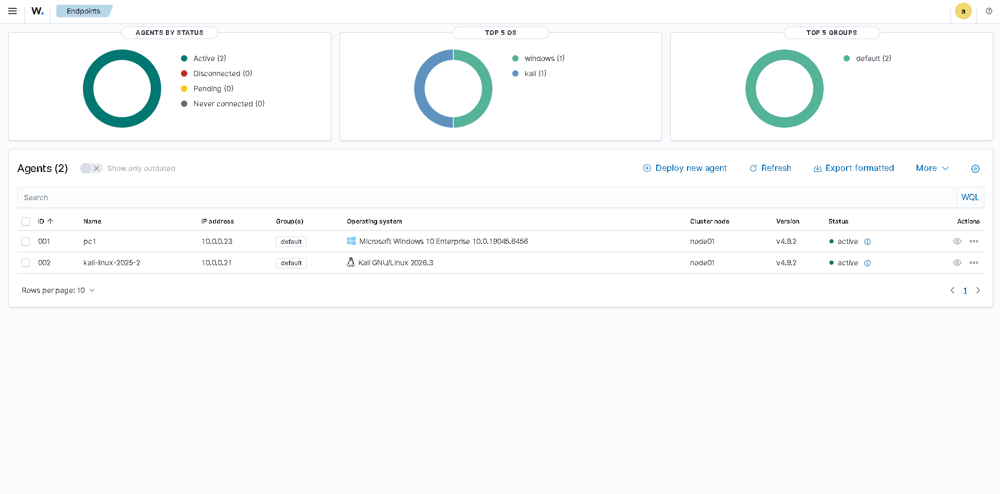
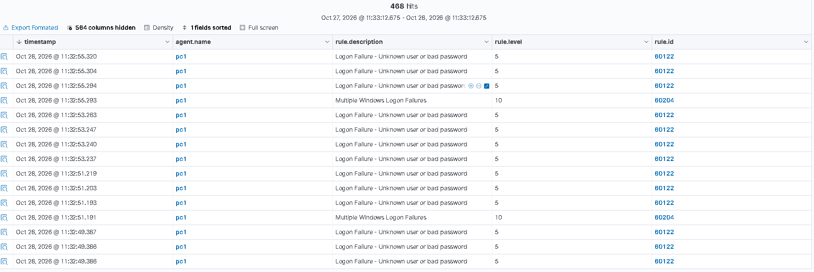
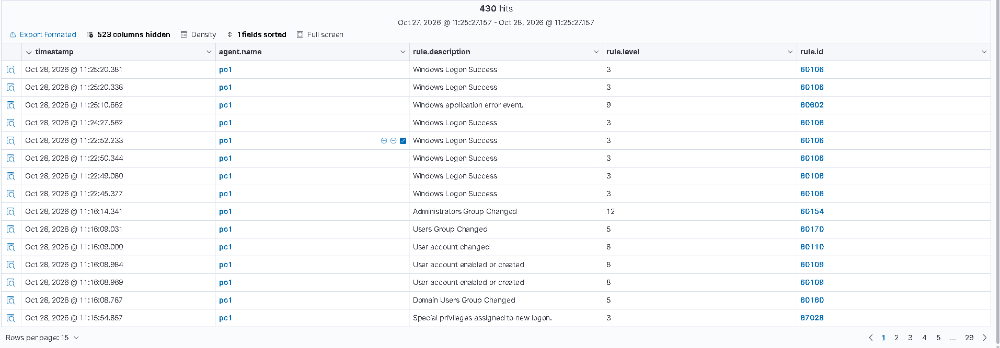
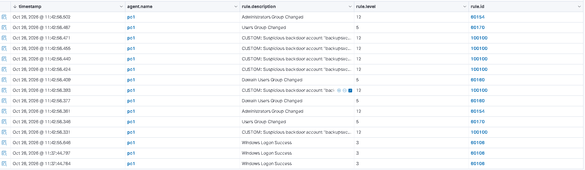
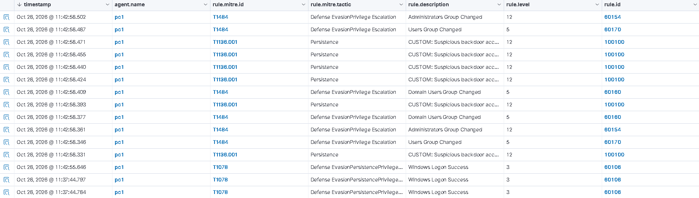
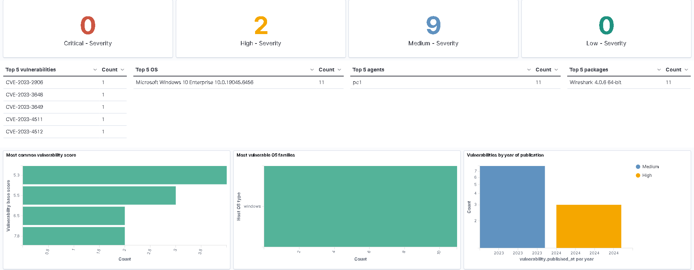

# 🏛️ Building a SOC with Wazuh — SIEM + XDR, Custom Detections & Attack Simulation

> I deployed a complete, open-source **Security Operations Center** from scratch using **Wazuh** (SIEM + XDR). I enrolled Windows and Kali endpoints as agents, simulated real attacks against them, watched the platform detect the full attack chain, and then **engineered my own custom detection rule** — mapped to MITRE ATT&CK — to catch a backdoor account. This is the difference between *using* a SIEM and *building and operating* one.
>
> My most advanced home-lab project: a distributed, multi-machine SOC.


---

## 📌 Table of Contents
1. [Summary](#-summary)
2. [Architecture](#-architecture)
3. [Part 1 — Deploying the SOC](#-part-1--deploying-the-soc)
4. [Part 2 — Catching a Brute-Force Attack](#-part-2--catching-a-brute-force-attack)
5. [Part 3 — Catching Post-Exploitation](#-part-3--catching-post-exploitation)
6. [Part 4 — Engineering a Custom Detection Rule](#-part-4--engineering-a-custom-detection-rule)
7. [Part 5 — MITRE Mapping & Vulnerability Detection](#-part-5--mitre-mapping--vulnerability-detection)
8. [Troubleshooting (real-world lessons)](#-troubleshooting-real-world-lessons)
9. [MITRE ATT&CK Coverage](#-mitre-attck-coverage)
10. [What I Learned](#-what-i-learned)
11. [Disclaimer](#-disclaimer)

---

## 📝 Summary

Most SOC projects stop at "I ran searches in a SIEM someone else set up." This one goes further: I **built the whole platform**. Wazuh is a free, open-source SIEM *and* XDR — it collects logs, does file-integrity monitoring, vulnerability detection, and active response, all driven by agents installed on the endpoints.

I deployed a Wazuh server, enrolled a **Windows** victim and a **Kali** attacker as agents across two physical machines, then:
- ran an **RDP brute-force** attack → the SOC flagged it as *Multiple Windows Logon Failures*
- created a **backdoor admin account** → the SOC caught the full creation-and-privilege-escalation chain
- **wrote my own detection rule** that fires a high-severity, MITRE-tagged alert specifically for that backdoor account
- reviewed the built-in **MITRE ATT&CK** and **Vulnerability Detection** modules

---

## 🏗️ Architecture

A distributed lab across two physical machines on an isolated network.

| Role | Host | Agent/Server |
|------|------|-----|
| 🧠 **SOC Server** | Ubuntu Server 22.04 (on a PC) | Wazuh manager + indexer + dashboard |
| 🎯 **Victim** | Windows 10 (`pc1`) | Wazuh agent |
| 🔴 **Attacker** | Kali Linux (`kali-linux-2025-2`) | Wazuh agent |

Both agents enrolled and reporting to the server — **Active**:



---

## 🚀 Part 1 — Deploying the SOC

I installed the Wazuh all-in-one stack (manager, indexer, dashboard) on Ubuntu Server:
```bash
curl -sO https://packages.wazuh.com/4.9/wazuh-install.sh
sudo bash ./wazuh-install.sh -a
```
Then enrolled each endpoint as an agent, pointing them at the server. The Windows agent is a one-line MSI deployment; the Kali agent a DEB package — both configured with `WAZUH_MANAGER=<server-ip>`.

---

## 🔓 Part 2 — Catching a Brute-Force Attack

From Kali, I ran an RDP brute-force against the Windows victim:
```bash
hydra -t 4 -V -f -l administrator -P /usr/share/wordlists/rockyou.txt rdp://<windows-ip>
```

Wazuh detected it immediately — a flood of **"Logon Failure – Unknown user or bad password"** (rule 60122), and crucially a correlated **"Multiple Windows Logon Failures"** alert (rule 60204, level 10) that recognizes the *pattern* as a brute-force, not just individual failures:



---

## 🕵️ Part 3 — Catching Post-Exploitation

Simulating what an attacker does after getting in, I created a hidden admin account on the Windows victim:
```cmd
net user backupsvc P@ssw0rd123! /add
net localgroup administrators backupsvc /add
```

The SOC caught the entire chain automatically — account created, account enabled, and the high-severity **"Administrators Group Changed"** (rule 60154, level 12) when the backdoor was granted admin:



---

## 🛠️ Part 4 — Engineering a Custom Detection Rule

This is the core of the project. Out of the box, Wazuh reports a *generic* "Administrators Group Changed." I wanted my SOC to raise a **specific, named, high-severity alert** the moment this particular backdoor account appears — so I wrote my own rule in `/var/ossec/etc/rules/local_rules.xml`:

```xml
<group name="local,custom,">
  <rule id="100100" level="13">
    <if_group>windows</if_group>
    <field name="win.eventdata.targetUserName">backupsvc</field>
    <description>CUSTOM: Suspicious backdoor account "backupsvc" activity detected</description>
    <mitre>
      <id>T1136.001</id>
    </mitre>
  </rule>
</group>
```

After restarting the manager and re-triggering the activity, **my custom rule (ID 100100) fires** — with my description and severity:



This is detection engineering: I turned a vague built-in alert into a precise, actionable one tailored to a specific threat.

---

## 🗺️ Part 5 — MITRE Mapping & Vulnerability Detection

Wazuh automatically maps alerts to **MITRE ATT&CK**. My custom rule shows up tagged **T1136.001 (Create Account) – Persistence**, right alongside the built-in group-change detections mapped to **T1484**:



The **Vulnerability Detection** module (the XDR side) scanned the agents and surfaced real CVEs in installed software — here, outdated packages on the Windows endpoint, scored by severity:



---

## 🧯 Troubleshooting (real-world lessons)

Building this wasn't plug-and-play — and working through the failures was part of the learning:

- **"Service Unavailable" / dashboard dying:** root cause was the **indexer running out of disk** (`java.io.IOException: No space left on device`). The VM's partition was only using half the virtual disk — I reclaimed it with `lvextend` + `resize2fs`, going from a full 24 GB to 48 GB.
- **Agent "service name is invalid":** the agent was installed but the service wasn't started — fixed with `Start-Service -Name "Wazuh*"`.
- **Dashboard lost its API connection:** the disk-full event had emptied `wazuh.yml`; I rebuilt the `hosts:` block with the `wazuh-wui` API credentials and restarted the dashboard.

These are exactly the kind of issues a real SOC engineer debugs — sizing, service health, and config integrity.

---

## 🗺️ MITRE ATT&CK Coverage

| Tactic | Technique | ID | Detected by |
|--------|-----------|-----|-------------|
| Credential Access | Brute Force | T1110 | Rule 60204 (Multiple Logon Failures) |
| Persistence | Create Account: Local Account | T1136.001 | **My custom rule 100100** |
| Privilege Escalation / Defense Evasion | Domain Policy / Group Modification | T1484 | Rule 60154 (Administrators Group Changed) |

---

## 💡 What I Learned

- **Deploying a full SOC platform** end to end — manager, indexer, dashboard, and distributed agents across separate machines.
- **Agent enrollment & management** for both Windows and Linux endpoints (SIEM + EDR in one).
- **Detection engineering** — writing custom Wazuh rules with severity levels and MITRE tags, not just consuming built-in ones.
- **Reading correlated detections** — the difference between single logon failures and a *pattern* alert that means "brute force."
- **Operating & troubleshooting the stack** — disk sizing, service health, and API/config recovery, the unglamorous-but-essential side of running a SOC.

---

## ⚠️ Disclaimer

> Built entirely within an isolated home lab I own. All attacks were launched against my own virtual machines for educational and defensive purposes only. Credentials shown in screenshots belong to the throwaway lab and were rotated.

---

<p align="center"><i>An advanced SOC-engineering project — deploy, detect, and engineer custom detections with Wazuh.</i></p>
